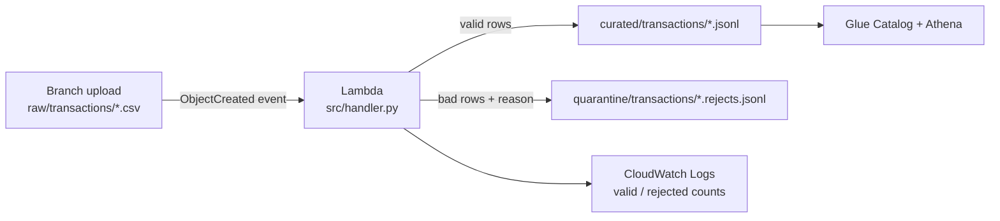

# Lab 02 – Event-driven ingestion: S3 → Lambda → curated / quarantine

## Scenario
A bank's partner branches drop daily transaction CSVs into `s3://bfsi-landing-dev/raw/transactions/`.
Instead of waiting for a nightly batch, an **S3 ObjectCreated event** triggers a **Lambda** that validates
each file within seconds: clean rows land in `curated/` as JSON Lines, bad rows go to `quarantine/` with a
reason so the ops team can fix and replay them. Nothing is silently dropped.

## Architecture


## Validation rules
| Rule | Reject reason |
|------|---------------|
| `txn_id, account_id, txn_ts, amount, currency` present | `missing <col>` |
| amount is numeric and ≥ 0 | `amount not numeric` / `negative amount` |
| currency in INR, USD, EUR, GBP (case-insensitive) | `unknown currency X` |
| ISO-8601 timestamp | `bad txn_ts` |
| `txn_id` unique within the file | `duplicate txn_id in file` |
| header has every required column | whole file fails (raises) so the event goes to retry / DLQ |

## Files
- `src/handler.py` – Lambda handler (`handler.lambda_handler`)
- `tests/test_handler.py` – pytest + moto, no AWS account needed
- `sample_data/txns_2026-10-29.csv` – 8 rows: 3 valid, 5 deliberately bad
- `events/s3_put_event.json` – sample S3 event for a console test

## How to run (local, no AWS)
```bash
cd lab-02-lambda-s3-events
python -m venv .venv && source .venv/bin/activate
pip install -r requirements.txt
pytest -q
```

## Deploying on AWS (outline)
1. Create the Lambda (Python 3.12) with handler `handler.lambda_handler`, code from `src/`.
2. IAM role: `s3:GetObject` on `raw/*`, `s3:PutObject` on `curated/*` and `quarantine/*`, plus CloudWatch Logs.
3. Add an S3 event notification on the bucket: event `s3:ObjectCreated:*`, prefix `raw/transactions/`, suffix `.csv`.
4. Configure an on-failure destination or DLQ (SQS) for files that raise.
5. Keep outputs under a **different prefix** than the trigger so the Lambda cannot re-trigger itself.

## Common questions
**1. Why must the output prefix differ from the trigger prefix?**
If the Lambda wrote back under `raw/` with a `.csv` suffix it would trigger itself in a loop. Scoping the
notification by prefix and suffix, and writing to `curated/` and `quarantine/`, prevents recursive invocation.

**2. S3 can deliver the same event more than once. How is this handled?**
The output key is derived from the input key (`txns_2026-10-29.csv` → `txns_2026-10-29.jsonl`), so a retry
overwrites the same object rather than appending duplicates. The handler is idempotent.

**3. Why is the key passed through `unquote_plus`?**
Keys in S3 event payloads are URL-encoded: a space arrives as `+`, special characters as `%XX`. Without
decoding, `get_object` returns NoSuchKey for files like `day 1.csv`.

**4. Why quarantine bad rows instead of failing the whole file?**
One bad row should not block thousands of good ones. Row-level issues go to quarantine with a reason for
replay; only structural problems (missing header columns) fail the invocation so it is retried / sent to the DLQ.

**5. When would you not use Lambda for this?**
Lambda has a 15-minute timeout and limited memory/ephemeral storage. For multi-GB files or heavy joins I would
have the event start a Glue job or Step Functions workflow (or push to SQS and batch), keeping Lambda as the
lightweight trigger.

**6. How do you test this without an AWS account?**
`moto`'s `mock_aws` fakes S3 in-process. The client is created lazily inside the handler so the mock is active
before boto3 builds it.
