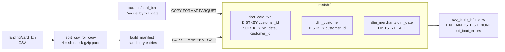

# Lab 03 – Redshift COPY, distribution keys and sort keys

## Scenario
The card-analytics team loads ~daily card transactions into Redshift and runs two queries all day:
monthly spend per customer segment (fact joined to `dim_customer`) and last-30-days dashboards
(date-range filters). The first version used `DISTSTYLE EVEN` everywhere and single large CSV loads:
the join redistributed the fact on every run and the nightly COPY used one slice.

This lab redesigns the tables so the hot join is local to each node, date filters skip blocks through
zone maps, and COPY loads in parallel across every slice.

## Architecture


## Design choices
| Table | Distribution | Sort key | Why |
|-------|--------------|----------|-----|
| `fact_card_txn` | `KEY(customer_id)` | compound `(txn_date, customer_id)` | Co-located with `dim_customer`; date-range queries prune by zone maps |
| `dim_customer` | `KEY(customer_id)` | `customer_id` | Large dimension, same key as the fact, so the join is `DS_DIST_NONE` |
| `dim_merchant`, `dim_date` | `ALL` | id / date | Small and read on every query; a full copy per node removes the broadcast |

Not chosen: `channel` or `status` as DISTKEY. With 3 distinct values only 3 slices get rows. The test
`test_low_cardinality_distkey_skews_badly` shows the skew (max slice / average) on the sample data.

## Files
- `sql/01_create_tables.sql` – DDL with DISTSTYLE, DISTKEY, SORTKEY and column encodings
- `sql/02_copy.sql` – Parquet COPY, gzip CSV + manifest COPY, idempotent day reload in one transaction
- `sql/03_checks.sql` – skew/unsorted from `svv_table_info`, rows per slice, `EXPLAIN` join check, `stl_load_errors`
- `src/copy_planner.py` – split a CSV into slice-sized gzip parts, build/upload a manifest, build COPY SQL, simulate slice skew, diststyle rule of thumb
- `src/make_sample.py` – writes `sample_data/card_txn.csv` (600 card transactions)
- `tests/test_copy_planner.py` – pytest + moto, no AWS account needed

## How to run (local, no AWS)
```bash
cd lab-03-redshift-copy-distkeys
python -m venv .venv && source .venv/bin/activate
pip install -r requirements.txt
python src/make_sample.py
pytest -q
```

## Running on AWS (outline)
1. Redshift Serverless workgroup (or a 2-node RA3 cluster), schema `analytics`, IAM role with `s3:GetObject`/`s3:ListBucket` on the lake buckets attached as the default role.
2. Run `sql/01_create_tables.sql`.
3. For CSV: split with `split_csv_for_copy` (slice count from `SELECT COUNT(*) FROM stv_slices`), upload the parts, `build_manifest` + `upload_manifest`, then COPY with `MANIFEST GZIP`.
4. For Parquet: COPY straight from the `txn_date=` prefix.
5. Run `sql/03_checks.sql`: `skew_rows` near 1, and the `EXPLAIN` join step shows `DS_DIST_NONE`.

## Common questions
**1. When do you pick DISTSTYLE KEY, ALL, EVEN or AUTO?**
KEY when a large table is joined on a high-cardinality column and the other side can use the same key, so
matching rows sit on the same slice. ALL for small, rarely updated dimensions read by most queries. EVEN for
tables with no dominant join. AUTO lets Redshift start with ALL and switch to EVEN/KEY as the table grows; it
is a good default when access patterns are unknown, but I set KEY explicitly on the fact when the join is known.

**2. What does DS_DIST_NONE vs DS_BCAST_INNER mean in EXPLAIN?**
`DS_DIST_NONE`: no data moves, the join is local. `DS_BCAST_INNER`: the inner table is copied to every node for
this query. `DS_DIST_BOTH`: both sides are redistributed, which is the most expensive. The goal of the DISTKEY
design is to make the main join `DS_DIST_NONE`.

**3. Why split the input into a multiple of the slice count?**
COPY assigns files to slices. One 10 GB file is read by one slice while the rest are idle. With
slices x k equally sized gzip parts every slice loads in parallel. Parquet is split by row groups so this matters
less there.

**4. Why use a manifest instead of a prefix?**
A prefix loads whatever is there, including a `_SUCCESS` marker, a late file from yesterday, or nothing at all.
A manifest lists exact files and `mandatory: true` makes COPY fail if one is missing, so the load is explicit
and repeatable.

**5. Compound vs interleaved sort key?**
Compound sorts by the first column, then the next; it is best when queries filter on a leading column (here
`txn_date`). Interleaved weights columns equally and helps when filters vary, but it costs more on VACUUM
REINDEX and degrades with inserts. For time-series facts loaded by date, compound on the date column is the
usual choice.

**6. How do you make a daily reload idempotent?**
COPY into a temp staging table, then `DELETE` that day from the target and `INSERT` from staging inside one
transaction. A rerun replaces the day instead of appending duplicates, and readers never see a half-loaded day.
