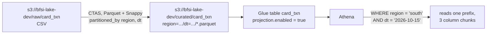

# Lab 04 – Athena partition projection and cost tuning

## Scenario
The card-transactions table in the curated zone gets a new partition per region per day. Analysts and a fraud
dashboard query it all day long. Two problems showed up:

1. New data was invisible until someone ran `MSCK REPAIR TABLE` or the crawler finished, and queries spent
   time listing thousands of partitions from the Glue catalog.
2. The monthly Athena bill grew with every dashboard, because many queries read raw CSV and filtered on
   expressions Athena could not use for pruning.

This lab fixes both: **partition projection** for the table, a **CTAS** to move CSV into partitioned Parquet,
and a set of query patterns, with a script that measures the bytes a typical query scans in each layout.

## Architecture


## Files
| File | What it is |
|------|-----------|
| `sql/01_create_table_projection.sql` | table DDL with `projection.*` and `storage.location.template` |
| `sql/02_ctas_csv_to_parquet.sql` | CSV to partitioned Parquet with CTAS (and the 100-partition limit) |
| `sql/03_query_patterns.sql` | bad vs good queries: `SELECT *`, functions on partition columns, `approx_distinct` |
| `src/projection.py` | renders the DDL, expands a filter into the S3 prefixes Athena reads, cost per query |
| `src/scan_compare.py` | builds CSV / flat Parquet / partitioned Parquet locally and measures bytes scanned |
| `tests/` | pytest, runs locally with pyarrow only |

## How to run (local, no AWS)
```bash
cd lab-04-athena-optimisation
python -m venv .venv && source .venv/bin/activate
pip install -r requirements.txt
pytest -q
python src/scan_compare.py --days 30 --rows-per-day 20000
```
Output on my laptop for 600k rows (one region, one day, 3 of 10 columns):
```
layout                         scanned   vs csv   cost/query  cost x10k/day
A csv, no partitions           50.93MB  100.0%    $0.000243          $2.43
B parquet, no partitions        3.12MB    6.1%    $0.000048          $0.48
C parquet, region/dt            0.04MB    0.1%    $0.000048          $0.48
```
B and C cost the same here because both are under Athena's 10 MB minimum per query. At real volumes
(hundreds of GB per month) the gap between B and C becomes the bill, and the floor stops mattering.

## On AWS
1. Run `sql/02_ctas_csv_to_parquet.sql` in chunks of at most 100 partitions (or use a Glue job for big backfills).
2. Create the table with `sql/01_create_table_projection.sql`. No crawler schedule is needed for partitions.
3. New daily data just has to land under `region=<r>/dt=<yyyy-MM-dd>/`; it is queryable immediately.
4. Put the dashboards on a workgroup with a **per-query data scanned limit** so a missing filter fails fast
   instead of scanning the whole table.

## Interview notes
**1. What does partition projection solve?**
Athena normally asks the Glue catalog for the partition list, which needs crawlers or `MSCK REPAIR` to stay
current and gets slow with many thousands of partitions. With projection, partition values and locations are
computed from table properties, so new partitions are visible as soon as files land and planning is faster.

**2. When is projection a bad fit?**
When partition values are not predictable (random IDs, high-cardinality keys that are not dates or enums), or
when other engines that read the Glue catalog directly (EMR Spark, Redshift Spectrum) also need the partitions,
since they ignore projection properties. Also, a query that filters no partition column makes Athena consider
every projected value, so the date range should not be wider than it needs to be.

**3. Why did query 3 in `03_query_patterns.sql` scan everything?**
Wrapping the partition column in functions (`date_format(date_parse(dt, ...))`) means Athena cannot match the
literal against projected values, so it cannot prune. Comparing the raw column to literals (`dt BETWEEN ...`)
keeps pruning.

**4. Why does `LIMIT 100` not make `SELECT *` cheap?**
Billing is on bytes scanned. Without a partition filter and with all columns selected, Athena may still read a
lot of data before the limit is satisfied. Column selection and partition filters are what reduce scan size.

**5. CSV vs Parquet, how much does it really change?**
Parquet is columnar and compressed, so a query touching 3 of 10 columns reads only those column chunks. In the
lab's measurement that alone dropped the scan to about 6% of the CSV size, and partitioning by region and day
took it to about 0.1%.

**6. What else do you tune besides layout?**
File sizes (aim for roughly 128 MB+ files; thousands of tiny files slow down listing and reads), `approx_distinct`
instead of `COUNT(DISTINCT)` for dashboards, CTAS or materialised summary tables for repeated heavy queries, and
workgroup scan limits plus query result reuse to cap spend.
