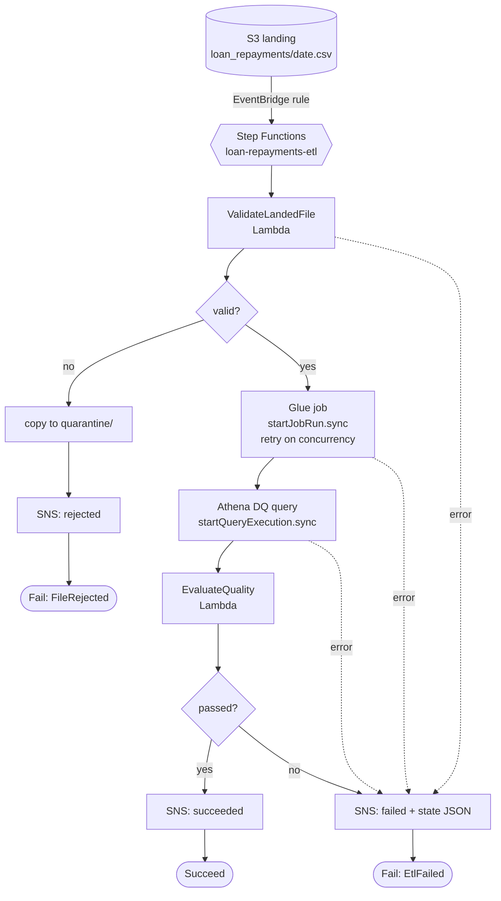

# Lab 05 – Step Functions ETL orchestration

## Scenario
Every evening the collections system drops a loan repayments CSV (`landing/loan_repayments/<date>.csv`) into
the lake bucket. Before it is usable downstream it has to be checked, transformed by a Glue job, and
verified. The old setup was a cron Lambda that started the Glue job and hoped; when the file came in
with a missing column, Glue failed at 2 a.m. and nobody knew until the morning reports were empty.

This lab orchestrates the run with **AWS Step Functions**:

1. a Lambda validates the landed file (columns, business date, not empty) before any Glue cost
2. bad files are copied to `quarantine/` and an alert goes out
3. the Glue job runs with the `.sync` integration, so the state machine waits for it and retries on
   `ConcurrentRunsExceededException` with backoff
4. an Athena query checks row count, null keys and non-positive amounts, and a Lambda decides pass/fail
5. success or failure is published to SNS, with the full state (including the error) on failure

## Architecture


## Files
| File | What it is |
|------|-----------|
| `state_machine/loan_repayments_etl.asl.json` | the state machine (ASL), with `${...}` placeholders filled by Terraform |
| `src/handlers.py` | `validate_landed_file` and `evaluate_quality` Lambda handlers |
| `src/sfn_local.py` | small local interpreter for the ASL subset used here, so routing can be tested without AWS |
| `tests/test_definition.py` | static checks: every `Next` exists, every state reachable, every work task has a `Catch` |
| `tests/test_flow.py` | runs the real ASL file with stubbed Lambda/Glue/Athena/SNS: happy path, quarantine, retries, DQ failure |
| `tests/test_handlers.py` | handler tests against S3 mocked with moto |
| `terraform/main.tf` | state machine, least-privilege IAM role, CloudWatch logging |
| `events/start_execution.json` | example execution input |

## How to run (local, no AWS)
```bash
cd lab-05-step-functions-etl
python -m venv .venv && source .venv/bin/activate
pip install -r requirements.txt
pytest -q
```

## On AWS
```bash
cd terraform
terraform init
terraform apply -var validate_function_arn=... -var dq_function_arn=... \
                -var glue_job_name=loan-repayments-curate -var alerts_topic_arn=...
aws stepfunctions start-execution --state-machine-arn <output arn> \
    --input file://../events/start_execution.json
```
To trigger it automatically, add an EventBridge rule on `Object Created` for the `landing/loan_repayments/`
prefix (S3 EventBridge notifications enabled on the bucket) with the state machine as target and an input
transformer that maps `detail.bucket.name` / `detail.object.key` to `bucket` / `key`.

## Design choices
- **Validation returns `valid: false` instead of raising.** Bad data is a business outcome and goes down the
  quarantine branch; only infrastructure errors raise, and those are the ones worth retrying.
- **Retries are per error type.** Glue concurrency limits get 4 retries with exponential backoff; a genuine
  job failure (`States.TaskFailed`) gets one retry, because re-running bad code five times only burns DPUs.
- **`ResultPath` keeps the input.** Each task writes into its own key (`$.validation`, `$.glue`, `$.dq`), so
  later states still see `bucket`, `key` and `business_date`, and the failure alert carries everything.
- **Standard workflow, not Express.** `.sync` integrations and a Glue job that can run past 5 minutes need
  Standard; at one execution a day the per-transition price is negligible.
- **Placeholders, not hardcoded ARNs.** The same ASL file is deployed to dev and prod through `templatefile`.

## Interview notes
**1. Why Step Functions instead of a Lambda that calls Glue?**
A Lambda can start a Glue job but cannot wait 40 minutes for it (15-minute limit), so you end up polling with
another schedule. Step Functions waits with `.sync`, has declarative retries and catches per error, keeps a
visual execution history for every run, and makes the failure path explicit instead of buried in code.

**2. What does `.sync` actually do?**
With `glue:startJobRun.sync` Step Functions starts the job and then tracks it until it finishes, failing the
task if the run fails. Without `.sync` (request-response) the task succeeds as soon as the run is started. The
execution role needs `GetJobRun`/`BatchStopJobRun` as well, which is a common IAM miss.

**3. Standard vs Express workflows?**
Standard: up to a year, exactly-once state transitions, full history, priced per transition, supports `.sync`
and callbacks. Express: up to 5 minutes, at-least-once, priced by duration and requests, meant for high-volume
short event processing. A nightly ETL is Standard.

**4. How do Retry and Catch interact?**
On an error the first `Retry` whose `ErrorEquals` matches is used until its `MaxAttempts` is spent; then the
first matching `Catch` sends the execution to its `Next` state with the error at `ResultPath`. If nothing catches
it, the execution fails. Order matters: put specific errors before `States.ALL`.

**5. How would you rerun one failed day safely?**
Start a new execution with that day's input. The Glue job overwrites only the `business_date` partition
(dynamic partition overwrite), the DQ check is a read, and the quarantine copy is idempotent, so a rerun gives
the same result. For a backfill of many days, a `Map` state over dates with `MaxConcurrency` set below the Glue
job's concurrent-run limit.

**6. How do you test a state machine before deploying it?**
Static checks on the ASL (targets exist, all states reachable, every task has a catch), then routing tests with
stubbed integrations as in `test_flow.py`, then Step Functions Local or the TestState API for single states, and
finally a dev deployment run with a small file.
