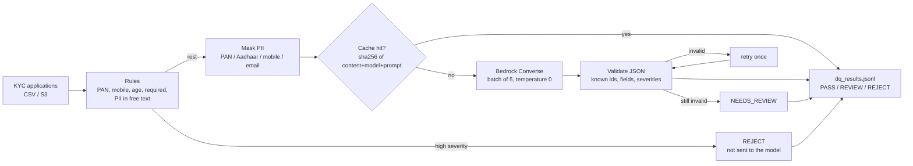

# Lab 06 – LLM data-quality checks on KYC applications with Amazon Bedrock

## Scenario
Branches key in customer onboarding (KYC) forms. Format rules catch a bad PAN or a short mobile number, but
they can't tell that an occupation of `asdf` is junk, that an employer field just repeats the occupation, that
₹9.5 crore a year is odd for a farmer, or that a remark like *"income is from husband's business"* needs a
compliance look. Those are judgement calls, which is where an LLM helps.

The pipeline runs **cheap deterministic rules first**, masks PII, and only then sends the remaining free-text
fields to a model on **Amazon Bedrock** (Converse API) in small batches. Every record ends up `PASS`, `REVIEW`,
`REJECT` or `NEEDS_REVIEW` with the reasons attached.

## Architecture


## Files
```
prompts/kyc_semantic_checks.txt   the prompt: what to flag, what not to, exact JSON shape
src/rules.py                      deterministic checks, PII masking, the masked view the model sees
src/llm_dq.py                     batching, Converse call, response validation, retry, cache, token usage
src/run_dq.py                     CLI: CSV in, JSONL out, summary with calls / tokens / cost / time
sample_data/kyc_applications.csv  10 applications with a mix of clean and problem rows
tests/                            pytest, no AWS account needed
```

## How to run
```bash
cd lab-06-bedrock-llm-dq
python -m venv .venv && source .venv/bin/activate
pip install -r requirements.txt
pytest -q

# see exactly what would be sent to the model (no AWS call)
python src/run_dq.py --input sample_data/kyc_applications.csv --dry-run

# real run (needs Bedrock model access enabled for the model in that region)
python src/run_dq.py --input sample_data/kyc_applications.csv --out output/dq_results.jsonl \
    --region us-east-1 --model-id anthropic.claude-3-haiku-20240307-v1:0
```
The run prints status counts, number of Bedrock calls, cache hits, input/output tokens and an estimated cost.
`--price-in` / `--price-out` take the per-1K-token prices for the model you use; check the Bedrock pricing page
for current numbers. Running the same file twice makes no Bedrock calls the second time because of the cache.

Tests use a fake client for the flow (so the model's answers are scripted: clean, flagged, broken JSON) and
`botocore.stub.Stubber` on a real `bedrock-runtime` client to pin the Converse request shape.

## Rules vs model
| Check | Where | Why there |
|-------|-------|-----------|
| PAN format, 10-digit mobile, date of birth, age ≥ 18, required fields | rules | exact, free, explainable to an auditor |
| PAN / Aadhaar / mobile / email typed into a free-text field | rules | must be caught *before* text leaves the account |
| junk or placeholder text, wrong kind of value in a field | model | needs language understanding |
| income implausible for the occupation | model | judgement, no fixed threshold per job |
| remarks that hint at a compliance concern | model | phrasing varies too much for keywords |

## Deploying on AWS
- Run it as a Glue Python shell job or a Lambda per file (S3 event), reading from `raw/kyc/` and writing results
  to `dq/kyc/` for Athena.
- IAM: `bedrock:InvokeModel` on the one model ARN (Converse uses the same permission), `s3:GetObject` /
  `s3:PutObject` on the prefixes. Nothing else.
- Enable model access for the chosen model in the Bedrock console first, otherwise calls fail with
  `AccessDeniedException`.
- Keep the cache in S3 or DynamoDB instead of a local file when it runs on Lambda.
- Large backfills: Bedrock batch inference (JSONL in S3) is cheaper than on-demand calls.
- Bedrock Guardrails with PII filters can be added as a second layer on top of the masking here.

## Interview notes
**1. Why not send every record straight to the LLM?**
Cost, latency and explainability. Rules decide anything that is black and white in microseconds for free, and
an auditor can read them. On the sample, 4 of 10 records are rejected by rules and never cost a token. The
model only handles what rules can't judge.

**2. How do you stop customer PII from going to the model?**
The model only gets a view with the free-text columns (no name, PAN, mobile or DOB), and those columns are
regex-masked for PAN, Aadhaar, mobile and email. If PII shows up in a free-text field that is itself a
high-severity issue and the record is rejected before any call. `--dry-run` prints the exact prompt so this can
be reviewed. Bedrock also does not use prompts to train models and traffic can stay in-region or go through a
VPC endpoint.

**3. LLM output is non-deterministic. How do you make it safe to use in a pipeline?**
Temperature 0, a prompt that fixes the JSON shape, and strict validation of the answer: valid JSON, every id we
sent comes back once, unknown ids are dropped, only known fields and severities are accepted. One retry on a bad
answer; after that the records are marked `NEEDS_REVIEW` instead of guessing PASS. The model can flag, it never
silently approves.

**4. How do you control cost?**
Rules first, batching 5 records per call so the instruction part of the prompt is paid once per batch, a
small fast model (Haiku class) for classification, and a cache keyed on record content + model id + prompt
version so reruns and duplicate rows are free. Token usage from every Converse response is summed and printed
as an estimated cost per run.

**5. Why is the prompt version part of the cache key?**
If I change the prompt, old cached answers were produced under different instructions and shouldn't be reused.
Hashing the prompt file into the key invalidates the cache automatically when the prompt changes, same for a
model change.

**6. How do you test code that calls Bedrock without an AWS account?**
Two layers: a fake client with a `converse` method returning scripted answers (clean, flagged, broken JSON)
tests the flow and the retry logic; `botocore.stub.Stubber` on a real `bedrock-runtime` client checks the
request parameters against the service model, so a wrong field name fails the test.

**7. Why the Converse API instead of InvokeModel?**
Converse has one request/response format across model providers, so switching from Claude to Llama or Titan is
a `--model-id` change, not a new request body. It also returns token usage in a standard place.
