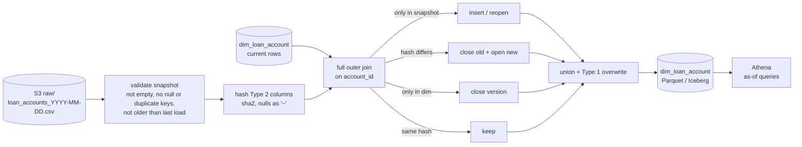

# Lab 07 – SCD Type 2 in PySpark from daily full snapshots

## Scenario
The loan servicing system has no CDC. Every night it drops a full extract of the loan-account table
(`loan_accounts_YYYY-MM-DD.csv`) on S3. Risk and regulatory reporting need history: *which interest rate and
asset classification (ACTIVE / SMA-1 / NPA) did this loan have on the reporting date, and which branch owned it?*
Overwriting the table every night loses that.

This lab builds `dim_loan_account` as an SCD Type 2 dimension by diffing each snapshot against the current
versions:

| Columns | Type | On change |
|---------|------|-----------|
| `product_code`, `interest_rate`, `emi_amount`, `branch_code`, `account_status` | Type 2 | close current version, open a new one |
| `customer_name`, `mobile` | Type 1 | overwrite on every version, no new version (corrections) |
| account missing from the snapshot | — | close the current version (closed / written off) |
| account back after being missing | — | new version with `change_type = reopen` |

Validity is half-open by snapshot date, `[effective_from, effective_to)`, with `9999-12-31` as the open end.

## Architecture


## Files
```
src/scd2_snapshot.py        apply_snapshot(), apply_type1(), as_of(), load_all(), CLI
src/make_snapshots.py       daily extract generator: rate resets with EMI recalculated, branch transfers,
                            SMA-1/NPA moves, name/mobile corrections, closures, reopens, new disbursals
sample_data/snapshots/      four days of extracts used in the walkthrough
sql/iceberg_scd2_merge.sql  the same load as MERGE INTO / INSERT on an Iceberg table (Athena or Glue)
tests/                      pytest on local Spark
```

## How to run
```bash
cd lab-07-pyspark-scd2
python -m venv .venv && source .venv/bin/activate
pip install -r requirements.txt          # Java 11 or 17 on PATH for Spark
pytest -q

python src/make_snapshots.py --days 4 --accounts 12 --out sample_data/snapshots
python src/scd2_snapshot.py --snapshots sample_data/snapshots --out output/dim_loan_account
```
On the four sample days the load ends with 19 rows: 14 current (10 untouched since day one, 3 updated,
1 reopened) and 5 closed versions. `LN000004` shows the closure/reopen path: it is missing from the
2026-11-03 extract and comes back on 2026-11-04.

The main test (`test_generated_history_rebuilds_every_snapshot_and_keeps_invariants`) loads six generated days
and checks that `as_of(dim, day)` gives back exactly that day's extract for every day, plus one current row per
account, no zero-length windows and unique surrogate keys.

## Running it on AWS
- Glue 4.0 Spark job triggered when the day's file lands (EventBridge on S3 `Object Created`, or a schedule
  after the extract SLA). Job parameters: snapshot path and date.
- Store the dimension as an Iceberg table in the Glue catalog. The Spark code here writes a full new version,
  which is fine for a few million accounts; for bigger books use the `MERGE INTO` in
  [`sql/iceberg_scd2_merge.sql`](sql/iceberg_scd2_merge.sql), which only rewrites the files holding changed rows.
- Iceberg snapshots give rollback for free: if a bad extract got through, `CALL system.rollback_to_snapshot`
  and reload.
- Keep the raw extracts in S3 with a lifecycle rule to Glacier; they are the source for any full rebuild.

## Interview notes
**1. Why compare a hash instead of each column?**
One expression per side and one comparison, and adding a tracked column means changing the list, not the join
condition. Nulls are coalesced to `~` before hashing, otherwise `concat_ws` would skip them and `NULL -> ''`
would look unchanged. Decimals are cast to string so `9.5` and `9.50` from a `DECIMAL(5,2)` hash the same.

**2. How do you detect deletes when the source has no delete flag?**
Full snapshot means "absent = gone", so a full outer join shows accounts that are current in the dimension but
missing from the extract, and their version is closed. That only works because the extract is complete,
which is why an empty snapshot is refused: a failed export of zero rows would otherwise close every loan.

**3. Type 1 vs Type 2 in the same table?**
Interest rate, EMI, branch and asset classification matter for point-in-time reporting, so they are Type 2. A
typo fix in the customer name is not a business event, and reporting wants the corrected name on all history,
so it is Type 1 and overwritten on every version without creating one. The Type 1 columns are left out of the
hash so a correction alone never opens a version.

**4. Is the load idempotent? What if a snapshot arrives late?**
Re-running the same day's snapshot is a no-op: the current rows already match it. A snapshot older than the last
loaded day is refused, because applying it would close today's versions with an earlier date. The fix for a
late or corrected extract is to roll the table back to before that day and reload the days in order.

**5. Snapshot diff vs CDC?**
Snapshot diff is easy and works with any source that can export a file, but it reads the whole table every
day and only sees one state per day; two changes on the same day show up as one. CDC (Debezium from the WAL)
sees every commit and can order by LSN. If the source can give CDC, use it for intra-day history; snapshot diff
is the right tool for a vendor system or mainframe extract.

**6. Why `localCheckpoint()` between days in `load_all`?**
Each day's dimension is built from the previous one, so without cutting the lineage the plan for day N
contains days 1..N and planning time grows every day. In the Glue job each run only applies one day, so this
only matters for backfills.

**7. How do you query it?**
`WHERE :d >= effective_from AND :d < effective_to`. Half-open windows mean a date never matches two versions,
and the open end `9999-12-31` keeps the filter the same for current rows (no `OR effective_to IS NULL`).
