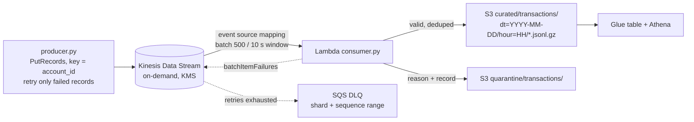

# Lab 08 – Kinesis Data Streams → Lambda → S3 (UPI / card transactions)

## Scenario
A payments team publishes every UPI, card and NEFT transaction as an event. Fraud and risk analysts want the
events queryable in Athena within a minute or two, partitioned by hour, with bad events kept aside instead of
silently lost. The producer must survive throttling on a busy shard, and the consumer must not block the
stream or create duplicate files when Lambda retries a batch.

## Architecture


## Files
- `src/producer.py` – sample transaction maker, `send()` with batching (500 records / 5 MB) and partial-failure retry, `shards_needed()` sizing helper
- `src/consumer.py` – Lambda handler (`consumer.lambda_handler`)
- `tests/` – pytest with moto (Kinesis, S3) and a fake throttling client, no AWS account needed
- `events/kinesis_batch.json` – a Kinesis event with three records for a console test
- `terraform/main.tf` – stream, bucket, Lambda, event source mapping, DLQ, IAM

## How to run (local, no AWS)
```bash
cd lab-08-kinesis-streaming
python -m venv .venv && source .venv/bin/activate
pip install -r requirements.txt
pytest -q
```

## Running it on AWS
```bash
cd terraform && terraform init && terraform apply
cd .. && python src/producer.py --stream lab08-transactions --count 2000
aws s3 ls s3://lab08-txn-lake-<account-id>/curated/transactions/ --recursive
```
Tear down with `terraform destroy` (on-demand streams bill per hour while they exist).

## Design choices
**Partition key = `account_id`.** Kinesis keeps order per shard, and a partition key always maps to one shard,
so every event of an account is read in order. That matters for rules like "three debits in 60 seconds".
A random key would spread load better but lose the order; with millions of accounts the spread is fine anyway.
A hot key (one merchant account doing thousands of events a second) is the case where you add a suffix
and give up strict order for that key.

**Retry only the failed records.** `PutRecords` returns HTTP 200 even when some records were throttled;
`FailedRecordCount` and the per-record `ErrorCode` say which ones. Re-sending the whole batch would duplicate
the records that already went in. The producer re-sends just the failed ones with exponential backoff and
jitter, and returns what still failed after the last attempt so the caller can park it.

**Partial batch response instead of failing the whole batch.** With `ReportBatchItemFailures`, the consumer
returns the sequence number of the first record in the partition whose S3 write failed. Lambda checkpoints
everything before it and retries from there. `bisect_batch_on_function_error` splits a batch that keeps
crashing, and after 5 retries or one hour the record range goes to the SQS DLQ so the shard is not stuck.

**Validation does not cause retries.** A bad record will be bad on every retry, so it goes to `quarantine/`
with the reason and the batch moves on. Only infrastructure errors (S3 throttling) are retried.

**Idempotent object keys.** Keys are `shard-<first sequence number in the partition>`, so a retry of the same
batch overwrites the same object. A retry that starts mid-batch can still re-land a few rows under a new key,
so the curated table is at-least-once and Athena queries dedupe on `txn_id`
(`row_number() over (partition by txn_id order by _seq)`).

**Event time for partitions.** Rows are partitioned by `event_ts`, not arrival time, so a delayed event lands in
the hour it happened. `_arrival_ts` is kept on the row to measure lag.

**Shard sizing (provisioned mode).** A shard takes 1 MB/s or 1,000 records/s in and gives 2 MB/s out shared by
standard consumers. `shards_needed(2500, 0.5)` is 3 shards because of the record limit, not the bytes.
Enhanced fan-out gives each consumer its own 2 MB/s, which is why it is worth paying for once several apps read
the same stream. On-demand mode skips this sizing and is the default here.

**Kinesis Data Streams + Lambda vs Firehose.** Firehose would do buffering, gzip, S3 partitioning and retries
with no code (and can call a Lambda for transforms). I would pick Firehose for a plain "land it in S3" feed.
Streams + Lambda is used here because the same stream also feeds a real-time fraud consumer, and the landing
logic needs per-record validation, quarantine and dedupe that are easier to test as Python.

## Interview notes
**Q: What happens if Lambda fails halfway through a batch?**
Without partial batch response, the whole batch is retried and the shard is blocked until it succeeds or the
record expires. With `ReportBatchItemFailures` the function returns the first failed sequence number, Lambda
checkpoints before it and retries from there. Bisect, max retries, max record age and an on-failure
destination stop a poison batch from blocking the shard forever.

**Q: How do you guarantee ordering in Kinesis?**
Only within a shard. Use a partition key that groups what must stay ordered (here `account_id`). With
`parallelization_factor` > 1 Lambda still keeps order per partition key. Across accounts there is no order, and
the pipeline does not need one.

**Q: A producer gets `ProvisionedThroughputExceededException`. What do you do?**
Short term: retry only the failed records with backoff and jitter. Then check whether it is a hot key
(one shard throttled, others idle; look at `WriteProvisionedThroughputExceeded` per shard with enhanced shard
metrics) or real load (all shards near limits). Hot key: change the key or add a suffix. Real load: split
shards / increase shard count, or switch to on-demand.

**Q: Is this exactly-once?**
No. Kinesis and the Lambda event source are at-least-once, and so is the producer retry. The pipeline makes
duplicates harmless instead: in-batch dedupe on `txn_id`, deterministic object keys for whole-batch retries, and
dedupe on `txn_id` in the Athena view. For exactly-once results downstream you would merge into an Iceberg
table on `txn_id`.

**Q: How would you monitor this?**
`GetRecords.IteratorAgeMilliseconds` / Lambda `IteratorAge` for consumer lag (alarm if it grows), Lambda errors
and throttles, DLQ depth > 0, producer-side failed record count, and the quarantine count from the consumer's
log line through a metric filter.

**Q: When would you choose MSK over Kinesis?**
When the team already runs Kafka, needs Kafka Connect connectors (Debezium CDC), longer retention with compaction,
or very high throughput where per-shard pricing gets expensive. Kinesis wins on zero cluster management and
native integration with Lambda, Firehose and IAM.
