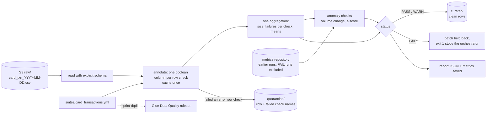

# Lab 09 – Data-quality framework for daily card transactions (Deequ-style checks in PySpark)

## Scenario
The card processor drops one file of the previous day's card transactions on S3 every morning
(`card_txn_YYYY-MM-DD.csv`). Settlement reconciliation, fraud features and the regulatory reporting mart all
read from `curated/card_transactions`. A bad file causes real damage downstream: a replayed batch doubles
spend, a paise/rupee mix-up inflates the average ticket 100x, a half-delivered file makes volumes look like
an outage.

So nothing is published to curated until it passes a suite of checks. The checks are written once in YAML,
run in PySpark (laptop, CI, Glue or EMR), and the same suite can be exported as an AWS Glue Data Quality
(DQDL) ruleset.

Three kinds of checks:

| Kind | Examples | What happens on failure |
|------|----------|-------------------------|
| Row checks | `txn_id` unique, amount in range, currency in list, BIN is 6 digits, settles on/after the txn date | failing rows go to quarantine with the names of the checks they failed; the batch fails only if compliance drops below `min_compliance` |
| Dataset checks | at least one row | batch fails |
| Anomaly checks | volume vs yesterday within ±50%, average ticket size within 3 standard deviations of the last 7 good runs | batch fails (`error`) or is flagged (`warn`) |

## Architecture


## Files
```
suites/card_transactions.yml   the checks: 11 row/dataset checks, 2 anomaly checks
src/dq/suite.py                YAML -> Check objects, validation of the suite itself
src/dq/engine.py               annotate rows, single-pass metrics, evaluate, split clean / quarantine
src/dq/repository.py           metrics per (dataset, run_date) in JSON lines, re-runs replace, FAIL runs kept out of baselines
src/dq/dqdl.py                 suite -> Glue Data Quality DQDL ruleset
src/dq/cli.py                  run one day's file: writes clean/, quarantine/, report/, exit 1 on FAIL
src/schema.py                  explicit schema for the processor file
src/make_transactions.py       daily file generator with injected defects (replays, bad BIN, bad currency, ...)
sample_data/                   two days of files used below
tests/                         pytest on local Spark
```

## How to run
```bash
cd lab-09-data-quality-framework
python -m venv .venv && source .venv/bin/activate
pip install -r requirements.txt          # Java 11 or 17 on PATH for Spark
pytest -q

cd src
python make_transactions.py --date 2026-11-04 --rows 400 --out ../sample_data/card_txn_2026-11-04.csv
python make_transactions.py --date 2026-11-05 --rows 420 --bad-rate 0.01 --out ../sample_data/card_txn_2026-11-05.csv
cd ..
for d in 2026-11-04 2026-11-05; do
  PYTHONPATH=src python -m dq.cli --data sample_data/card_txn_$d.csv --suite suites/card_transactions.yml \
      --run-date $d --repo output/metrics.jsonl --out output
done
PYTHONPATH=src python -m dq.cli --data x --suite suites/card_transactions.yml --run-date x --print-dqdl
```
On the two sample days both batches PASS: 2026-11-04 is clean, and 2026-11-05 (420 rows, volume +5% on the
day before) has two quarantined rows, one with a zero amount (`amount_in_range`) and one settling the day before
it happened (`settles_after_txn`). Both are under the 1% threshold, so the other 418 rows are published. The
avg-ticket check reports "needs 3 earlier runs" until the repository has enough good days.

Report shape (`output/report/2026-11-05.json`, trimmed):
```json
{
  "dataset": "card_transactions", "run_date": "2026-11-05", "status": "PASS",
  "rows": 420, "quarantined_rows": 4,
  "checks": [
    {"name": "amount_in_range", "metric": 0.997619, "threshold": "compliance >= 0.99",
     "passed": true, "failed_rows": 1, "sample_keys": ["T20261105000123"]},
    {"name": "volume_vs_yesterday", "metric": 0.05, "threshold": "|change| <= 50% vs previous run",
     "passed": true, "note": "previous size 400"}
  ]
}
```

## How the checks behave
- **Nulls belong to completeness.** Range, pattern, allowed-values and expression checks pass a null, so a
  missing value is reported once, by the check that owns it, and not five times.
- **Duplicates keep the first copy.** `unique` ranks rows per `txn_id` by `txn_ts`; the first copy stays, later
  copies go to quarantine. Quarantining both would drop a real transaction from settlement.
- **Quarantine threshold vs block threshold.** One bad amount in 400 rows should not stop the bank's morning
  reports, so `amount_in_range` has `min_compliance: 0.99`: the row is quarantined and the batch goes through.
  A wrong card BIN means the file layout shifted, so `card_bin_format` needs 100% and one bad row blocks the day.
- **Warn vs error.** `merchant_id_present` is an expression (`channel = 'ATM' OR merchant_id IS NOT NULL`)
  because ATM withdrawals never have a merchant; a plain completeness check would warn every single day. It and
  `mcc_format` are warnings because only spend analytics uses those fields. Warn failures stay in the clean data with
  `dq_warn_checks` listing what they tripped.
- **Baselines exclude bad days.** The metrics repository stores every run, but anomaly checks only compare
  against runs that did not FAIL, so a broken day does not become tomorrow's "normal". Re-running a day
  replaces its metrics instead of adding a second point.
- **Flat or short history.** The z-score check waits for `min_history` (3) earlier runs, and when the baseline
  has no variance it passes only an identical value instead of dividing by zero.

## Same suite in Glue Data Quality (DQDL)
`--print-dqdl` turns the YAML into a ruleset to attach to the Glue catalog table or use in a Glue job's
`EvaluateDataQuality` transform:
```
Rules = [
    RowCount >= 1,
    Completeness "txn_id" >= 1.0,
    Uniqueness "txn_id" >= 0.99,
    Completeness "account_id" >= 0.99,
    CustomSql "select avg(case when channel = 'ATM' OR merchant_id IS NOT NULL then 1.0 else 0.0 end) from primary" >= 0.99,
    ColumnValues "amount" >= 0.01 with threshold >= 0.99,
    ColumnValues "amount" <= 500000 with threshold >= 0.99,
    ColumnValues "currency" in ["INR", "USD", "EUR", "GBP", "AED", "SGD"] with threshold >= 0.99,
    ColumnValues "card_bin" matches "^[0-9]{6}$",
    ColumnValues "mcc" matches "^[0-9]{4}$",
    ColumnValues "channel" in ["POS", "ECOM", "ATM", "CONTACTLESS"],
    CustomSql "select avg(case when settlement_date >= to_date(txn_ts) then 1.0 else 0.0 end) from primary" >= 0.99,
    RowCount >= avg(last(1)) * 0.5,
    RowCount <= avg(last(1)) * 1.5
]
```
The z-score check has no one-line DQDL form, so it is reported as not translated rather than dropped quietly.
Ranges are written as `>=` and `<=` so both ends stay inclusive like the Spark check.

The same checks in PyDeequ (EMR with the Deequ jar), for comparison:
```python
from pydeequ.checks import Check, CheckLevel
from pydeequ.verification import VerificationSuite, VerificationResult

check = (Check(spark, CheckLevel.Error, "card_transactions")
         .hasSize(lambda n: n >= 1)
         .isComplete("txn_id")
         .hasUniqueness(["txn_id"], lambda u: u >= 0.99)
         .isContainedIn("currency", ["INR", "USD", "EUR", "GBP", "AED", "SGD"])
         .hasPattern("card_bin", r"^[0-9]{6}$"))
result = VerificationSuite(spark).onData(df).addCheck(check).run()
VerificationResult.checkResultsAsDataFrame(spark, result).show()
```
Deequ reports pass/fail per constraint but does not split rows into clean and quarantine; that row-level
split is the main reason this lab evaluates checks itself.

| This lab | Deequ | Great Expectations | Glue Data Quality |
|----------|-------|--------------------|-------------------|
| `completeness` | `isComplete` / `hasCompleteness` | `expect_column_values_to_not_be_null` (`mostly`) | `Completeness` |
| `unique` | `hasUniqueness` | `expect_column_values_to_be_unique` | `Uniqueness` |
| `range` | `isNonNegative`, `hasMin`, `hasMax` | `expect_column_values_to_be_between` | `ColumnValues >= / <=` |
| `allowed_values` | `isContainedIn` | `expect_column_values_to_be_in_set` | `ColumnValues in [...]` |
| `pattern` | `hasPattern` | `expect_column_values_to_match_regex` | `ColumnValues matches` |
| `expression` | `satisfies` | custom expectation | `CustomSql` |
| `row_count_change` | anomaly check, `RelativeRateOfChangeStrategy` | custom / checkpoint history | dynamic rule with `last(n)` |
| `metric_zscore` | anomaly check, `OnlineNormalStrategy` | custom | anomaly detection on analyzers |
| `min_compliance` | assertion lambda | `mostly` | `with threshold` |

## Running it on AWS
- A Glue 4.0 job (or a Step Functions task before the curated load) runs `dq.cli` logic on the day's file;
  the suite YAML ships with the job code from S3.
- `clean/`, `quarantine/` and `report/` are S3 prefixes; curated is only written on PASS/WARN, and a FAIL
  exits non-zero so the state machine goes to its alert branch (SNS) instead of loading.
- The metrics repository is a small JSON-lines object or an Iceberg/DynamoDB table keyed by dataset and run date.
- Quarantine is a Glue table too, so the ops team can query yesterday's rejected rows in Athena and send a
  correction file.
- For tables already in the catalog, the exported DQDL ruleset can be attached in Glue Data Quality so the
  same rules show up as scores in the console.

## Interview notes
**1. Why not just use Great Expectations or Deequ?**
Both are good, and the table above maps each check to them. Here I needed two things they do not give
together out of the box: a row-level split into clean and quarantine with the reason on each row, and one
YAML that runs on a laptop without a JVM jar and also exports to Glue Data Quality. The engine is small
(one annotate step and one aggregation), so it is easy to reason about. On a team already using GE, I would
write these as GE expectations and keep the quarantine step.

**2. How do you avoid scanning the data once per check?**
Each row check becomes a boolean column, the annotated frame is cached once, and size, failure counts and
means come out of a single `agg`. Sample keys for a failing check are an extra small `limit(5)` read, and only
for checks that failed.

**3. Block the batch or quarantine the rows?**
It depends on what the failure means. A few bad amounts are row problems: quarantine them and publish the rest.
A wrong BIN length or an empty file means the file itself is broken: block it. `min_compliance` encodes that
per check, so the decision is in the suite and visible in code review, not hidden in the job.

**4. How does the anomaly check avoid false alarms?**
It needs at least three earlier runs, uses only runs that passed, and compares with the last seven, so
seasonality older than a week does not distort it. Volume uses a relative change against yesterday, because a
half-delivered file is the common failure. For strong weekly patterns (salary days, month end) the next step is
comparing with the same weekday or day-of-month instead of yesterday.

**5. What is the difference between a warn and an error check?**
Error checks protect consumers: they quarantine rows or stop the batch. Warn checks are for things worth
knowing but not worth stopping settlement for, like a POS transaction with no merchant id. Warnings still show in the
report and on each row (`dq_warn_checks`), so a warning that fires every day is a sign the rule or the source
needs fixing.

**6. Why an explicit schema instead of inferSchema?**
With inference, one bad value in `amount` turns the whole column into a string and every numeric check
silently stops meaning anything. With a fixed schema the bad value becomes null and the completeness and range
checks catch it.

**7. How would you test the data-quality code itself?**
Every check has a test that builds a frame with exactly one broken row and asserts which row lands in
quarantine with which check name, plus tests for thresholds, warn-only batches, nulls, an empty file, the
anomaly paths (short history, volume drop, ticket-size jump) and the DQDL text. The generator injects the same
defect types, and an end-to-end test checks that clean plus quarantine add up to the input.
