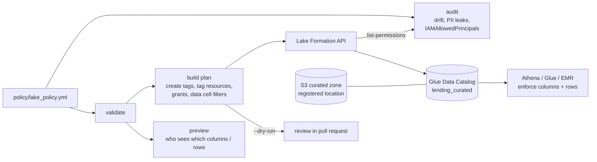
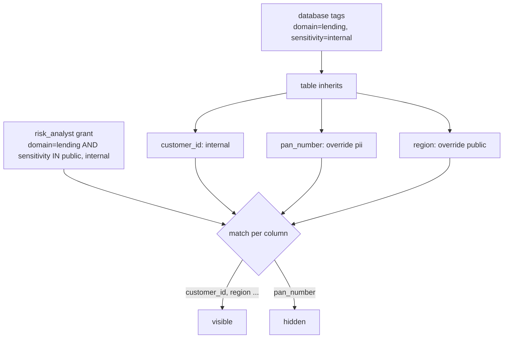

# Lab 10 – Lake Formation governance: LF-tags, PII columns and row filters for a lending lake

## Scenario
The `lending_curated` database holds customer master data and loan accounts. Four groups query it in Athena:

| Persona | Needs | Must not see |
|---------|-------|--------------|
| Data engineer | everything, plus ALTER/INSERT to maintain tables | - |
| Risk analyst | all customers and loans for portfolio risk | name, PAN, mobile |
| Compliance auditor | everything, read only | - |
| Branch ops (South) | only customers and loans of the South region | name, PAN, mobile, other regions |

With IAM and S3 bucket policies alone this is all-or-nothing per S3 prefix: there is no way to hide three columns
or half the rows of one Parquet table. Lake Formation adds column, row and cell level permissions on the Glue
catalog, and Athena, Glue and EMR enforce them.

Instead of granting table by table, the lab uses **LF-tags**: the database is tagged `domain=lending,
sensitivity=internal`, the three PII columns are tagged `sensitivity=pii`, and personas get grants on tag
expressions. A new table in the database is covered on the day it is created, and a new PII column is protected by
tagging it, not by editing every grant.

The policy lives in one YAML file (`policy/lake_policy.yml`). From it the lab:
1. validates the policy (unknown tags, columns, principals),
2. previews what each persona would see on sample rows,
3. builds and applies the Lake Formation API calls (with `--dry-run` for review),
4. audits the grants actually present in the account against the policy.

## Architecture


How a tag grant resolves for one table:


## Files
```
policy/lake_policy.yml         tags, tag assignments, persona grants, data cell filters
src/lfgov/policy.py            load + validate, effective column tags (database -> table -> column override)
src/lfgov/access.py            access paths per persona, row filter evaluator, preview on CSV rows
src/lfgov/apply.py             policy -> ordered Lake Formation calls; apply with boto3, re-run safe
src/lfgov/audit.py             compare list-permissions output with the policy
src/lfgov/cli.py               preview command
sample_data/                   customers, loan accounts, a permissions snapshot with problems in it
terraform/main.tf              the same setup with the AWS provider
tests/                         pytest, no AWS account needed (botocore Stubber checks every API call shape)
```

## How to run
```bash
cd lab-10-lake-formation
python -m venv .venv && source .venv/bin/activate
pip install -r requirements.txt
pytest -q

cd src
# what does each persona get on customers?
python -m lfgov.cli --policy ../policy/lake_policy.yml --principal risk_analyst \
    --table lending_curated.customers --csv ../sample_data/customers.csv
python -m lfgov.cli --policy ../policy/lake_policy.yml --principal branch_ops_south \
    --table lending_curated.customers --csv ../sample_data/customers.csv

# the API calls that would be made (16 calls for this policy)
python -m lfgov.apply --policy ../policy/lake_policy.yml --dry-run

# audit a list-permissions snapshot
python -m lfgov.audit --policy ../policy/lake_policy.yml --permissions ../sample_data/permissions_snapshot.json
```
Preview output for the South branch team:
```
branch_ops_south on lending_curated.customers: filter:customers_south_no_pii
customer_id | city | branch_code | region | risk_tier | kyc_status
C1001 | Hyderabad | HYD01 | SOUTH | LOW | VERIFIED
C1003 | Vijayawada | VJA02 | SOUTH | HIGH | PENDING
C1004 | Chennai | CHN01 | SOUTH | LOW | EXPIRED
3 rows
```
Audit of the sample snapshot (exit code 1):
```
ERROR iam_allowed_principals   lending_curated            IAM_ALLOWED_PRINCIPALS  IAM-only access is still on; ...
ERROR pii_direct_grant         lending_curated.customers  ...role/risk-analyst     direct grant exposes PII columns ['full_name', 'pan_number', 'mobile']
WARN  grant_option             lending_curated.loan_accounts ...role/risk-analyst  can re-grant ['SELECT']
ERROR broad_permission         lending_curated.customers  ...user/temp.contractor  non-admin holds ['DROP']
ERROR pii_direct_grant         lending_curated.customers  ...user/temp.contractor  direct grant exposes PII columns ['full_name', 'mobile']
...
9 findings, 4 errors
```
The contractor grant excludes `pan_number` but still exposes name and mobile, which is exactly the kind of
half-fix that the audit is there to catch.

To deploy with Terraform instead of the Python apply:
```bash
cd terraform
terraform init
terraform plan -var 'lake_bucket_arn=arn:aws:s3:::my-lake' \
  -var 'admin_role_arns=["arn:aws:iam::111122223333:role/lending-data-engineer"]' \
  -var 'role_arns={data_engineer="...",risk_analyst="...",compliance_auditor="...",branch_ops_south="..."}'
```

## What the checks and rules do
| Audit check | Severity | Why it matters |
|-------------|----------|----------------|
| `iam_allowed_principals` | error | while `IAMAllowedPrincipals` holds a grant, any IAM principal with S3/Glue access reads the table and Lake Formation permissions change nothing |
| `pii_direct_grant` | error | a table or column grant that reaches a PII column for someone without a `pii` tag grant |
| `broad_permission` | error | `ALL` or `DROP` held by a non-admin |
| `grant_option` | warn | the principal can pass the permission on, outside any review |
| `iam_user_principal` | warn | grants should go to roles, so access follows the job and not the person |
| `direct_grant_drift` | warn | a named-table grant that is not in the tag policy (usually an old console fix) |

Policy rules enforced at load time: every tag key and value exists, tagged columns exist in the table, filters use
either a column list or exclusions (not both), every principal and admin is defined, filter names are unique.

## Notes on the design
- **Tags over named grants.** Named grants grow with tables x personas. Tag grants grow with personas only, and
  the PII decision sits on the column, where the data steward can see it.
- **Column override.** Columns inherit the database tag (`internal`) and only the exceptions are tagged
  (`pii`, `public`). Lake Formation lets a column override the inherited value of the same key.
- **Row filters with data cell filters.** The South team is the only persona with row restrictions, so they get
  a data cell filter (row expression plus column exclusions) instead of a tag grant. The preview refuses to
  guess when one persona has two SELECT paths on the same table, because Lake Formation combines them and the
  result is easy to misread; the policy keeps one path per persona per table.
- **Settings are merged, not replaced.** `PutDataLakeSettings` overwrites the whole document, so the apply reads
  the current settings first, adds the admins and empties the default IAM grants for new databases and tables.
- **Idempotent apply.** "Already exists" counts as done, any other error stops the run, so a half-applied policy
  is visible instead of skipped.

## Running it on AWS
- Register the S3 curated location with Lake Formation (`aws_lakeformation_resource`) so it vends credentials to
  Athena and Glue; the IAM roles then need no direct S3 read on that prefix.
- Revoke `IAMAllowedPrincipals` on existing databases and tables after the tag grants are in place, not before,
  or current jobs lose access.
- Glue jobs run with a role that is granted through the same tags (the data engineer persona here).
- Run the audit on a schedule (EventBridge -> Lambda calling `list_permissions`) and alert on errors.
- For cross-account sharing, tag-based grants to another account go through AWS RAM; the consumer account then
  grants to its own roles.

## Interview notes
**1. Why use Lake Formation instead of IAM and S3 bucket policies?**
IAM decides access per S3 object or prefix. A Parquet file holds all columns and all rows, so IAM cannot hide the
PAN column or other regions' rows. Lake Formation works on catalog objects (database, table, column, row, cell),
and the engines that read through the catalog (Athena, Glue, EMR, Redshift Spectrum) enforce it with temporary
credentials vended by Lake Formation.

**2. What is LF-TBAC and when is it better than named-resource grants?**
Tag-based access control: tag databases, tables and columns, then grant on tag expressions such as
`domain=lending AND sensitivity IN (public, internal)`. It scales with the number of personas instead of
tables x personas, new tables are covered automatically, and moving a column to `pii` is one tag change.
Named grants are still fine for a handful of special cases like a single shared table.

**3. What is `IAMAllowedPrincipals` and why does it matter?**
For backward compatibility, Lake Formation gives the `IAMAllowedPrincipals` group `Super`/`ALL` on new
resources by default, which means "IAM decides". As long as that grant exists, fine-grained permissions are not
enforced. The fix is to clear the default permissions in the data lake settings and revoke the grant on existing
resources once the real grants are in place. The audit treats it as an error for that reason.

**4. How do you give a team only some rows and some columns?**
A data cell filter: a row filter expression (`region = 'SOUTH'`) plus a column list or column exclusions,
defined on one table and granted like a table. That is how the South branch team sees only South customers and
never the PII columns.

**5. How do you stop permissions drifting from what was approved?**
Keep the policy in code (YAML or Terraform), apply it from CI, and audit regularly by comparing
`list-permissions` with the policy: direct table grants, grant options, IAM users, `ALL`/`DROP` for non-admins and
any path to a PII column for someone who should not have one.

**6. How did you test this without an AWS account?**
The policy, the tag inheritance, the row filter evaluation and the audit are plain Python. The apply is tested
with botocore's Stubber: every expected call is registered with its exact parameters, and Stubber also validates
them against the Lake Formation API model, so a wrong field name fails the test. `terraform validate` checks the
Terraform version.

**7. A Glue job fails with "Insufficient Lake Formation permission(s)" after onboarding. What do you check?**
That the job role has a grant (tag or named) covering the table and the columns it reads, `DESCRIBE` on the
database, and that the S3 location is registered (otherwise Lake Formation has no data location to vend). For
writes it needs `INSERT`/`ALTER` on the table and data location permission on the target path.
