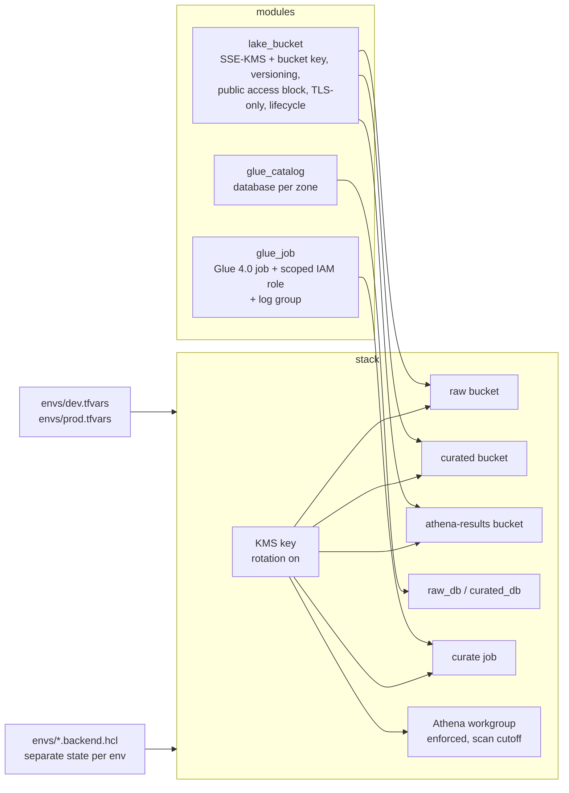
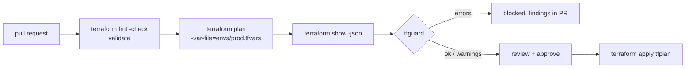

# Lab 11 – Terraform modules for a data stack, with plan checks before apply

## Scenario
A lending data domain needs the same platform in dev and prod: a raw and a curated S3 zone, an Athena results
bucket, a Glue database per zone, a Glue job that curates raw loan files, and an Athena workgroup for analysts.
Copy-pasting `.tf` files per environment drifts quickly: someone fixes encryption in prod and forgets dev, a
bucket gets created without the public access block, a job role ends up with `s3:*`.

This lab splits the stack into three small modules that carry the guardrails inside them, composes them once
in `stack/`, and drives dev and prod from tfvars and separate state backends. Before `apply`, a Python checker
(`tfguard`) reads the plan JSON and blocks changes that break the rules a regulated (BFSI) data platform
has to follow: encryption, no public access, required tags for cost and data classification, no wildcard IAM,
no accidental destroy of buckets, keys or catalog databases in prod, and sane Glue sizing.

## Architecture


How a change gets to prod:


## Files
```
terraform/modules/lake_bucket/   bucket + public access block + ownership + versioning + SSE-KMS + lifecycle + TLS-only policy
terraform/modules/glue_catalog/  Glue database with default location
terraform/modules/glue_job/      Glue 4.0 job, IAM role scoped to input buckets / one output prefix / given databases, log group
terraform/stack/                 the domain stack: KMS key, three buckets, two databases, curate job, Athena workgroup
terraform/envs/                  dev.tfvars, prod.tfvars, <env>.backend.hcl
src/tfguard/plan.py              plan JSON -> resource changes (module, type, actions, after)
src/tfguard/rules.py             the guardrail rules and per-env limits
src/tfguard/cli.py               check a plan, exit 1 on errors, optional JSON report
sample_plans/                    a clean prod plan and a risky one with a dozen problems in it
tests/                           pytest: rules, CLI, and static checks on the .tf files (no terraform or AWS needed)
```

## How to run
```bash
cd lab-11-terraform-data-stack
python -m venv .venv && source .venv/bin/activate
pip install -r requirements.txt
pytest -q

# check the sample plans
cd src
python -m tfguard.cli ../sample_plans/prod_good_plan.json --env prod
python -m tfguard.cli ../sample_plans/prod_risky_plan.json --env prod --json /tmp/report.json
```
Output for the risky plan (trimmed):
```
plan: 10 to create, 1 to update, 1 to replace, 1 to destroy
[ERROR] bucket_encryption: module.curated.aws_s3_bucket.this - SSE is AES256, lake buckets use aws:kms
[ERROR] bucket_force_destroy: module.raw.aws_s3_bucket.this - force_destroy=true in prod
[ERROR] bucket_public_access: aws_s3_bucket.adhoc_exports - no public access block next to the bucket
[ERROR] destructive_change: aws_kms_key.lake - replace of a protected resource in prod
[ERROR] glue_job_size: module.curate_job.aws_glue_job.this - 40 workers > 20 allowed in prod
[ERROR] iam_wildcard: module.curate_job.aws_iam_role_policy.job - Allow s3:* on Resource * (sid Everything)
[ERROR] required_tags: module.curated.aws_s3_bucket.this - missing tags: cost_center
...
12 error(s), 3 warning(s) -> BLOCKED
```

Validate and plan the real stack (needs Terraform >= 1.5 and AWS credentials for plan):
```bash
cd terraform/stack
terraform init -backend=false && terraform validate          # no AWS needed
terraform init -backend-config=../envs/dev.backend.hcl
terraform plan -var-file=../envs/dev.tfvars -out tfplan
terraform show -json tfplan > plan.json
PYTHONPATH=../../src python -m tfguard.cli plan.json --env dev
```

## What the rules check
| Rule | Severity | Why |
|------|----------|-----|
| `bucket_public_access` | error | all four public access flags must be true for every bucket |
| `bucket_encryption` | error | SSE must be `aws:kms` (customer key, auditable in CloudTrail), not AES256 or missing |
| `bucket_versioning` | warn | overwritten or deleted objects can be recovered |
| `bucket_force_destroy` | error in prod | `terraform destroy` would empty a prod bucket |
| `required_tags` | error | `owner`, `cost_center`, `data_classification`, `environment` present; environment tag matches the plan's env |
| `iam_wildcard` | error / warn | Allow `*` or `service:*` on Resource `*` is an error; a scoped wildcard is a warning; Deny statements are ignored |
| `destructive_change` | error in prod | destroy or replace of buckets, KMS keys, Glue databases/tables, DynamoDB tables unless the address is passed to `--allow-destroy` |
| `glue_job_size` | error | worker cap per env (dev 4, prod 20) |
| `glue_version` | error | Glue 4.0 or newer |
| `glue_timeout` | warn | Glue's default timeout is 48 hours, which hides a stuck job |
| `athena_workgroup` | error / warn | workgroup config must be enforced; a bytes-scanned cutoff should be set |

## Notes on the design
- **Guardrails live in the module, checks live on the plan.** The module makes the right thing the default;
  `tfguard` catches what bypasses the module, like a bucket declared directly in the stack (`adhoc_exports` in
  the risky plan) or a hand-edited role policy.
- **Why check the plan and not the `.tf` files?** The plan is what will actually happen: variables resolved,
  modules expanded, provider `default_tags` merged into `tags_all`, and the action for every resource (create,
  update, replace, destroy). Regex on HCL cannot see a replace caused by a changed `name`.
- **Matching bucket companions by module.** In a plan the bucket id is unknown until apply, so the public access
  block and SSE config cannot be joined to the bucket by id. They are matched by module address instead, which
  works because the lake_bucket module always creates them together, and fails for a bare bucket, which is the
  case worth catching.
- **Replace is treated as destroy.** `["delete","create"]` on a KMS key or a Glue database loses data or breaks
  every table location pointing at it, so it needs the same explicit allow as a destroy.
- **One stack, tfvars per env, separate state.** Dev and prod differ only in values (workers, retention,
  force_destroy, scan cutoff). Separate backend buckets mean a dev apply can never lock or corrupt prod state.
- **Default tags at the provider.** Tags are set once in `default_tags`; modules only add their own (zone).
  The rule reads `tags_all` so it sees the merged set.
- **Scoped job role.** The Glue role reads the input buckets, writes only under `curated/tables/`, and can update
  tables only in its two databases. `s3:DeleteObject` is needed because Spark overwrites partitions.

## Running it on AWS
1. Create the state bucket and lock table per environment once (or with a separate bootstrap stack).
2. `terraform init -backend-config=../envs/<env>.backend.hcl`.
3. In CI: fmt check, validate, plan with the env tfvars, `terraform show -json`, run `tfguard`; upload the
   report to the pull request. Apply only the saved `tfplan` after approval so what was checked is what runs.
4. In prod, an intended destroy (for example dropping a retired database) is passed explicitly with
   `--allow-destroy module.raw_db.aws_glue_catalog_database.this` so it shows up in review.

## Interview notes
**Q1. How do you structure Terraform for multiple environments?**
One root stack built from small modules, environments as tfvars plus a backend config each, so dev and prod run
the same code with different values. Separate state per environment (separate bucket, or at least key) with a
DynamoDB lock table. I avoid one folder per environment with copied code because fixes drift between them.

**Q2. Why put encryption and public access block inside a module instead of documenting them?**
Because nobody reads the wiki at 7 pm. If the only way to get a lake bucket is the module, every bucket gets
SSE-KMS, versioning, the public access block and the TLS-only policy. The plan check then catches anyone who
creates `aws_s3_bucket` directly.

**Q3. What is the difference between checking `.tf` files and checking the plan JSON?**
The plan shows resolved values and the action per resource. A renamed Glue database shows up as a replace only
in the plan. Static tools (tflint, checkov on HCL) are still useful earlier; plan checks are the last gate before
apply. OPA/Conftest or Sentinel do the same thing; I wrote it in Python here to keep the rules readable and tested.

**Q4. How do you stop someone from destroying a prod bucket by accident?**
Several layers: `force_destroy = false` in prod, `prevent_destroy` lifecycle on critical resources if the team
agrees, the plan check that blocks destroy/replace of protected types unless the address is explicitly allowed,
versioning on the bucket, and a separate prod role for apply that only CI can assume.

**Q5. Why SSE-KMS with a bucket key rather than SSE-S3?**
SSE-KMS gives a customer-managed key with rotation, key policy control over who can decrypt, and CloudTrail logs of
every decrypt, which auditors ask for in banking. The bucket key reduces KMS requests (and cost) a lot for Spark jobs
that read and write thousands of objects.

**Q6. How do you keep Glue job permissions least-privilege?**
Role per job, read on the input buckets, write on one prefix of the output bucket, Glue catalog actions only on the
databases and tables it touches, KMS decrypt/generate on the lake key and logs on the Glue log groups. The plan check
flags any `Allow` with `*` actions on `*` resources.

**Q7. What tags do you require and why?**
`owner` (who to call), `cost_center` (chargeback in Cost Explorer), `data_classification` (drives Lake Formation and
retention decisions), `environment`. Set once with provider `default_tags`, verified on `tags_all` in the plan, and
activated as cost allocation tags in billing.
