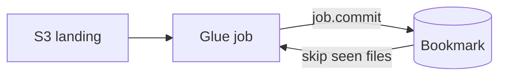

# Lab 14: Glue job bookmarks for incremental loads

**Scenario (BFSI):** daily loan-repayment files land under `loans/dt=YYYY-MM-DD/`. The Glue job must load only new files each run, and must not lose files when a run fails.

| Concern | Behaviour |
|---|---|
| New file | Processed once, then recorded in the bookmark |
| Rewritten file (new last-modified) | Processed again, so downstream needs idempotent writes (MERGE or overwrite partition) |
| Failed run | Bookmark not advanced; next run retries the same files |
| Reprocess | Reset the bookmark (`aws glue reset-job-bookmark`) |

Glue needs `--job-bookmark-option job-bookmark-enable`, a `transformation_ctx` on every source, and `job.commit()` at the end.



`src/bookmark.py` models this logic locally.

## How to run (local, no AWS)
```bash
pip install pytest
cd lab-14-glue-job-bookmarks && python -m pytest -q tests
```
