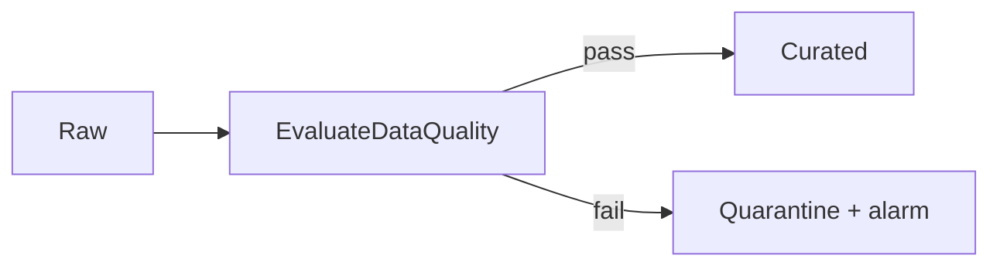

# Lab 15: Glue Data Quality (DQDL) rules

**Scenario (BFSI):** card transactions must pass quality gates before they reach the curated zone: no duplicate `txn_id`, no missing keys, amounts in range, known channels.

| DQDL rule | Checks |
|---|---|
| `RowCount >= 1` | File is not empty |
| `IsComplete "txn_id"` | No null or empty keys |
| `IsUnique "txn_id"` | No duplicate keys |
| `ColumnValues "amount" between 0 and 1000000` | Amount range |
| `ColumnValues "channel" in ["UPI","ATM","POS"]` | Allowed values |

In Glue, attach a ruleset with `EvaluateDataQuality.apply(...)` in the job and publish results to CloudWatch; fail the job or route bad rows based on the outcome.



`src/dqdl.py` evaluates a small DQDL subset locally so rulesets can be unit tested.

## How to run (local, no AWS)
```bash
pip install pytest
cd lab-15-glue-data-quality-dqdl && python -m pytest -q tests
```
